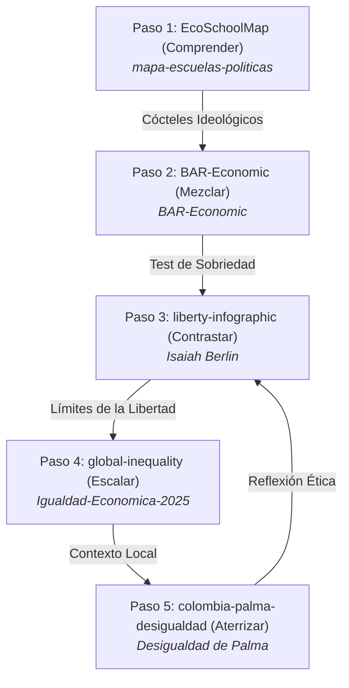

# 🗺️ Mapa de Escuelas Políticas y Económicas · EcoSchoolMap

### *An interactive scrollytelling essay & continuous 2D visualization of 12 economic schools of thought based on Ha-Joon Chang's pluralist taxonomy.*
### *Visualización interactiva y ensayo académico cartográfico de las 12 escuelas de pensamiento económico en un plano cartesiano continuo.*

---

[](https://willkwolf.github.io/EcoSchoolMap/)
[](https://github.com/willkwolf/EcoSchoolMap)
[](https://creativecommons.org/licenses/by-sa/4.0/)
[](https://d3js.org/)
[](openwiki/overview.md)
[](https://vitejs.dev/)

---

## 🌐 Demo en Vivo / Live Demonstration
👉 **[Explorar visualización interactiva en GitHub Pages / View Live Demo](https://willkwolf.github.io/EcoSchoolMap/)**

---

## 🧭 La Ruta del Pensamiento Crítico / The Critical Thinking Ecosystem

Este proyecto constituye el **Paso 1 (Comprender)** dentro de **"La Ruta del Pensamiento Crítico"**, una red de 5 artefactos web interactivos creados por [`@willkwolf`](https://github.com/willkwolf) para conectar teoría económica, dilemas filosóficos, brechas materiales y realidades locales:



> [!NOTE]
> **Estás en el Paso 1: Comprender**. Aquí mapeamos la base teórica y los descriptores de 12 escuelas de pensamiento para estructurar tu caja de herramientas conceptual. Al final de la página, un banner te invitará a mezclar estos conocimientos en el **Paso 2: El Bar de Cócteles Económicos**.

---

## 📖 Philosophical & Theoretical Framework / Fundamento Académico

### Pluralist Economics (Ha-Joon Chang)
The project is built upon the pluralist epistemological premise articulated by heterodox economist **Ha-Joon Chang** (*Economics: The User's Guide*, 2014): **no single economic theory holds a monopoly on truth**. Economic theory is not a monolithic Newtonian science of universal constants, but a dynamic, dialogical arena of competing analytical lenses.

Each tradition exhibits a distinct **Weltanschauung** (worldview) shaped by historical crises, defining unique analytical units, behavioral assumptions, and policy instruments.

### Dimensionality Reduction to a 2D Cartesian Space
The map formalizes this taxonomy by projecting a high-dimensional descriptor space $\mathcal{D}^6$ into a continuous 2D plane $[-1.0, +1.0]^2$ defined by two structural tensions:

```
                    +1.0 (Y: Equidad y Justicia Social / Equity & Social Welfare)
                               ▲
                               │
               Cuadrante II    │    Cuadrante I
            (Socialdemócrata / │  (Marxista /
               Keynesiano)     │   Feminista /
                               │   Desarrollista Social)
                               │
-1.0 ──────────────────────────┼──────────────────────────► +1.0 (X: Coordinación Colectiva / State Coordination)
(Mercado / Market Laissez-faire)│
               Cuadrante III   │    Cuadrante IV
             (Austríaca /      │  (Desarrollismo Puro /
              Neoclásica pura) │   Capitalismo de Estado)
                               │
                               ▼
                    -1.0 (Y: Crecimiento y Acumulación / Growth & Capital Accumulation)
```

1. **X-Axis (Institutional Coordination Mechanism):** Decentralized market pricing & private initiative ($-1.0$) vs. Deliberate collective coordination, public planning & industrial policy ($+1.0$).
2. **Y-Axis (Socioeconomic Objective - Okun's Trade-off):** Productive efficiency, supply expansion & capital accumulation ($-1.0$) vs. Distributive justice, social welfare & collective rights ($+1.0$).

### Conceptual Space vs. Feasible Space / Espacio Conceptual vs. Factible
The visible Cartesian plane is a **conceptual space** (what theories prescribe). As formalized in our academic monograph, real-world policy feasibility is strictly bounded by **transversal physical layers**:
* **Biophysical & Thermodynamic Ceilings (Nicholas Georgescu-Roegen & Herman Daly):** Low entropy matter-energy throughput limits, rendering infinite material growth physically impossible.
* **Planetary Boundaries (Johan Rockström):** Tipping points and non-convex forbidden ecological domains.
* **Complex Adaptive Systems / CAS (W. Brian Arthur & J. Doyne Farmer):** Path-dependent phase spaces, basins of attraction, and heavy tails.
* **Doughnut Economics (Kate Raworth):** The safe and just operating space bounded between social foundations and ecological ceilings.

---

## 🏛️ Architecture & Governance / Gobernanza del Repositorio

The repository enforces a strict architectural boundary separating **Data** from **Conceptualization**:

```
.
├── data/
│   └── escuelas.json               # Canonical dataset (Single Source of Truth)
├── docs/                           # Production site (GitHub Pages) & Academic Documentation
│   ├── index.html                  # Built production application
│   ├── assets/                     # Production compiled bundles
│   ├── data/                       # Production synchronized data
│   ├── schemas/
│   │   └── escuelas.schema.json    # JSON Schema (Draft-07) data contract
│   ├── contracts/                  # Formal Governance Contracts
│   │   ├── README.md               # Compliance checklist & governance overview
│   │   ├── DATA_GOVERNANCE_CONTRACT.md   # Data integrity & descriptor rules
│   │   ├── VISUAL_AND_UI_CONTRACT.md     # Mathematical projection & physics invariants
│   │   └── AGENT_GOVERNANCE_CONTRACT.md  # Autonomous AI agent operating guidelines
│   ├── conceptual/                 # Academic Research & Epistemological Foundations
│   │   ├── README.md               # Overview of conceptual framework
│   │   ├── 01_epistemologia_espacio_2d.md      # 2D space epistemology & embedding
│   │   ├── 02_espacio_conceptual_vs_factible.md # Decisional nodes vs. Transversal layers
│   │   ├── 03_taxonomia_escuelas_chang.md      # Chang's 12 schools comparative taxonomy
│   │   └── 04_ensayo_academico.md              # Full Academic Monograph (APA 7)
│   └── methodology/
│       └── SCORING_METHODOLOGY.md  # Dynamic scoring engine & normalization mathematics
├── openwiki/                       # OpenWiki Knowledge Base for Humans & AI Agents
│   ├── INSTRUCTIONS.md             # Agent guidelines
│   ├── overview.md                 # System overview
│   ├── architecture.md             # Data flow & software architecture
│   └── contracts.md                # Contract registry
├── src/                            # Modern ES6 + D3.js + GSAP frontend source
├── scripts/                        # Automated build tools & validation pipelines
├── AGENTS.md                       # Root AI Agent Entry Point
└── package.json                    # Dependencies & build scripts
```

---

## ⚙️ Mathematical Engine & Scoring Methodology

### The 6 Core Qualitative Descriptors
Positions $(X, Y)$ are computed dynamically using 6 normalized dimensions evaluated in $[0.0, 1.0]$:

1. **Conception of the Economy (`concepcion_economia`):** `0.0` = Individuals | `0.5` = Structures & Institutions | `1.0` = Social Classes.
2. **Conception of Human Agency (`concepcion_humano`):** `0.0` = Self-interested Rational Maximer (*Homo economicus*) | `1.0` = Bounded Rationality & Social Conditioning.
3. **Nature of the World (`naturaleza_mundo`):** `0.0` = Deterministic Equilibrium | `1.0` = Radical Uncertainty & Historical Contingency.
4. **Primary Economic Sphere (`ambito_economico`):** `0.0` = Production | `0.33` = Consumption | `0.67` = Market Exchange | `1.0` = Distribution.
5. **Engine of Economic Change (`motor_cambio`):** `0.0` = Capital Accumulation | `0.25` = Individual Action | `0.50` = Technological Innovation | `0.75` = Institutions & State Policy | `1.0` = Class Conflict.
6. **Preferred Policy Instruments (`politicas_preferidas`):** `0.0` = Free Market (*Laissez-faire*) | `0.50` = Mixed/Regulated Economy | `1.0` = State Planning & Industrial Direction.

### Dynamic Normalization Modes
* **Percentile (Uniform) [Default]:** Distributes nodes evenly across $[-1.0, 1.0]$ to optimize visual clarity and resolve central congestion.
* **Z-Score (Statistical):** Standardizes positions around empirical mean $\mu = 0$ with $\sigma$ unit distances, clipped to canvas bounds.
* **MinMax:** Stretches the relative distances to span the full viewport range.
* **None (Pure Theory):** Raw weighted sums clipped directly to $[-1.0, 1.0]$.

### Force Simulation & Visual Collision Invariants
To prevent label overlaps without falsifying theoretical positions, the D3 force simulation implements:
* **Base Collision Radius:** $45\text{px}$ minimum inter-node exclusion.
* **Repulsion & Centering Ratio:** Collision strength $1.0$ (8 iterations) vs. centering forces $0.05$ on X/Y.
* **Stochastic Micro-Offsets:** $0.001$ noise guardrail preventing exact mathematical overlaps (e.g. Marxist vs. Feminist under specific projections).
* **Klein Color Palette:** 11 distinct categorical sRGB hues ensuring maximum visual contrast without color repetition.

---

## 🛠️ Tech Stack / Tecnologías

| Component | Technology | Role |
| :--- | :--- | :--- |
| **Interactive Rendering** | [D3.js](https://d3js.org/) (v7.9) | Reactive SVG rendering, zoom/pan transforms & force physics |
| **Animation Engine** | [GSAP](https://greensock.com/gsap/) (v3.13) | Smooth tweening and variant transitions |
| **Bundler & Dev Server** | [Vite](https://vitejs.dev/) (v7.2) | Fast ESM compilation, asset hashing & GitHub Pages export |
| **Styles** | [Sass](https://sass-lang.com/) (v1.94) | Modular styles, responsive CSS grid & mobile-first media queries |
| **Knowledge Base** | [OpenWiki](https://github.com/langchain-ai/openwiki) | Synchronized Markdown documentation for AI agents |
| **Validation Pipeline** | Python 3.11+ / JSON Schema | Automated data integrity & schema consistency verification |

---

## 🚀 Installation & Local Development / Instalación

### Prerequisites
* **Node.js** 18+ (20+ recommended)
* **Python** 3.11+ (for data integrity checks)

### 1. Clone & Install
```bash
git clone https://github.com/willkwolf/EcoSchoolMap.git
cd EcoSchoolMap
npm install
```

### 2. Run Local Development Server
```bash
npm run dev
# -> Open http://localhost:3000
```

### 3. Validate Data Integrity
```bash
npm run validate-data
```

### 4. Build for Production (GitHub Pages)
```bash
npm run build
# -> Compiles into docs/ with assets hashing and copies data
```

---

## 📝 Citation / Cómo Citar (APA 7 & BibTeX)

If you use this visualization, its data taxonomy, or its academic essay in your research or teaching, please cite:

**APA 7th Edition:**
> Artunduaga Viana, W. C. (2025). *Mapa de Escuelas Políticas y Económicas: Una visualización basada en la Weltanschauung de Ha-Joon Chang* (Versión 2.0.0) [Software y Ensayo Académico]. GitHub. https://willkwolf.github.io/EcoSchoolMap/

**BibTeX:**
```bibtex
@software{Artunduaga_EcoSchoolMap_2025,
  author       = {Artunduaga Viana, William Camilo},
  title        = {{Mapa de Escuelas Políticas y Económicas: Una visualización basada en la Weltanschauung de Ha-Joon Chang}},
  year         = {2025},
  version      = {2.0.0},
  publisher    = {GitHub},
  howpublished = {\url{https://willkwolf.github.io/EcoSchoolMap/}},
  url          = {https://github.com/willkwolf/EcoSchoolMap}
}
```

---

## 📄 License & Attribution
* **Software & Code:** Licensed under the [MIT License](https://opensource.org/licenses/MIT).
* **Data, Visual Content & Academic Texts:** Licensed under [Creative Commons Attribution-ShareAlike 4.0 International (CC BY-SA 4.0)](https://creativecommons.org/licenses/by-sa/4.0/).
* **Author:** William Camilo Artunduaga Viana ([`@willkwolf`](https://github.com/willkwolf))
