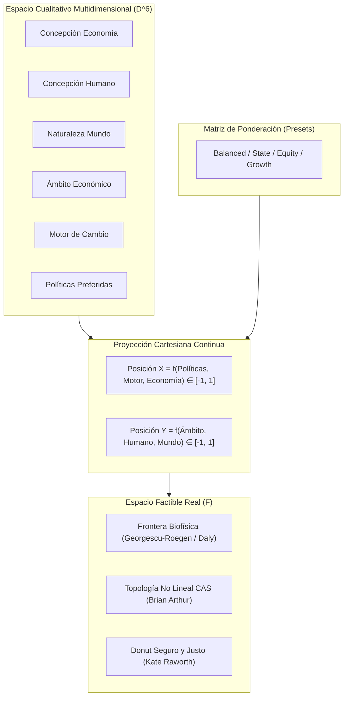

# 🎓 Cartografía Dinámica de la Economía Política: Un Ensayo Interactivo sobre la Taxonomía Pluralista de Ha-Joon Chang

> **Tipo de Documento:** Ensayo Académico y Memoria Metodológica  
> **Identificador:** POL-ED-ART-001  
> **Autor:** William Camilo Artunduaga Viana (`@willkwolf`)  
> **Versión:** 2.0.0  
> **Licencia:** [CC BY-SA 4.0](https://creativecommons.org/licenses/by-sa/4.0/)  
> **Cita Sugerida (APA 7):** Artunduaga Viana, W. C. (2025). *Cartografía Dinámica de la Economía Política: Un Ensayo Interactivo sobre la Taxonomía Pluralista de Ha-Joon Chang*. EcoSchoolMap Research Repository. https://willkwolf.github.io/EcoSchoolMap/

---

## Tabla de Contenidos

- [Resumen / Abstract](#resumen--abstract)
- [1. Introducción: Monismo Hegemónico y la Urgencia del Pluralismo](#1-introducción-monismo-hegemónico-y-la-urgencia-del-pluralismo)
- [2. Marco Metodológico: La Reducción Dimensional de la Weltanschauung](#2-marco-metodológico-la-reducción-dimensional-de-la-weltanschauung)
- [3. Las Tensiones Estructurales del Plano Cartesiano](#3-las-tensiones-estructurales-del-plano-cartesiano)
- [4. Ontología de la Realizabilidad: Espacio Conceptual vs. Espacio Factible](#4-ontología-de-la-realizabilidad-espacio-conceptual-vs-espacio-factible)
- [5. De Plotly a D3.js: La Retórica Procedural en la Educación Económica](#5-de-plotly-a-d3js-la-retórica-procedural-en-la-educación-económica)
- [6. Criterios de Gobernanza y Validación Empírica](#6-criterios-de-gobernanza-y-validación-empírica)
- [7. Conclusiones y Rutas de Investigación Futuras](#7-conclusiones-y-rutas-de-investigación-futuras)
- [8. Referencias Bibliográficas y Bloque de Citación](#8-referencias-bibliográficas-y-bloque-de-citación)

---

## Resumen / Abstract

**Español:**  
Este ensayo presenta la fundamentación teórica, matemática y pedagógica del *Mapa de Escuelas Políticas y Económicas* (`EcoSchoolMap`), un artefacto digital interactivo diseñado para enseñar economía pluralista a través de la retórica procedimental y el scrollytelling. Basado en la taxonomía de Ha-Joon Chang (2014), el proyecto sitúa 12 escuelas del pensamiento económico en un espacio continuo bidimensional acotado en $[-1.0, 1.0]^2$. Se formaliza la proyección cartesiana como una reducción dimensional de 6 descriptores cualitativos y se discute la distinción ontológica fundamental entre el *espacio conceptual* y el *espacio materialmente factible* delimitado por la termodinámica biofísica (Georgescu-Roegen, Daly) y los sistemas complejos adaptativos (Arthur, Farmer).

**English:**  
This essay presents the theoretical, mathematical, and pedagogical foundations of the *Political-Economic Schools Map* (`EcoSchoolMap`), an interactive digital artifact designed to teach pluralist economics through procedural rhetoric and scrollytelling. Drawing on Ha-Joon Chang's taxonomy (2014), the project situates 12 economic schools of thought on a continuous two-dimensional plane bounded in $[-1.0, 1.0]^2$. We formalize the Cartesian projection as a dimensionality reduction over 6 qualitative descriptors, and discuss the fundamental ontological distinction between *conceptual policy space* and the *materially feasible space* bounded by biophysical thermodynamics (Georgescu-Roegen, Daly) and complex adaptive systems (Arthur, Farmer).

---

## 1. Introducción: Monismo Hegemónico y la Urgencia del Pluralismo

Durante las últimas cuatro décadas, la enseñanza formal de la economía en la educación superior ha convergido hacia un monocultivo metodológico: la síntesis neoclásica contemporánea con modelos de equilibrio general dinámico estocástico (DSGE). Esta hegemonía ha marginado tradiciones intelectuales ricas en análisis institucional, sociología del poder, dinámica histórica y límites ecológicos, transmitiendo al público general la falacia de que la economía posee una única "verdad técnica" desprovista de juicios éticos.

Como argumenta el economista heterodoxo Ha-Joon Chang en *Economics: The User's Guide* (2014), el 95% de la economía no requiere cálculo multivariado abstracto, sino sentido común fundamentado en la historia y el reconocimiento explícito de que diferentes escuelas persiguen diferentes fines y observan diferentes objetos. La economía no es una ciencia axiomática cerrada similar a la física newtoniana; es una disciplina dialógica donde el desacuerdo teórico es una virtud epistémica.

Este artefacto nace con el objetivo de materializar visual e interactivamente la propuesta pluralista de Chang, transformando una taxonomía de textos estáticos en un **espacio navegable, computable y sensible a distintas lentes de ponderación**.

---

## 2. Marco Metodológico: La Reducción Dimensional de la Weltanschauung

Cada tradición del pensamiento económico posee una *Weltanschauung* (cosmovisión) irreductible a una única ecuación. Para formalizar esta taxonomía sin caer en el arbitrio subjetivo, se implementa un modelo de scoring determinista basado en 6 dimensiones cualitativas $\vec{d}_i \in [0.0, 1.0]^6$:

1. **Concepción de la Economía:** De la micro-atomización individualista a las clases sociales.
2. **Concepción del Ser Humano:** Del *homo economicus* maximizador de utilidad a la racionalidad limitada socialmente situada.
3. **Naturaleza del Mundo:** Del equilibrio estático predecible a la incertidumbre ontológica y el dinamismo histórico.
4. **Ámbito Económico Principal:** De la oferta y producción al intercambio de mercado o la redistribución.
5. **Motor del Cambio:** De la acumulación ciega de capital a la innovación tecnológica, las instituciones o la lucha social.
6. **Políticas Preferidas:** Del *laissez-faire* a la planificación estatal deliberada.



La proyección en dos dimensiones opera como un **algoritmo de reducción dimensional supervisado**:

$$\Phi(\vec{d}_i, W) = \begin{pmatrix} f_X(\vec{d}_i, W_X) \\ f_Y(\vec{d}_i, W_Y) \end{pmatrix} \in [-1.0, +1.0]^2$$

Donde la matriz de pesos $W$ no es una constante dogmática, sino una variable de interacción que el usuario puede mutar mediante presets analíticos (*Balanced*, *State Emphasis*, *Equity Emphasis*, *Growth Emphasis*, etc.). Esto permite al estudiante observar en tiempo real cómo cambia la topología del mapa cuando se altera la jerarquía de valores del observador.

---

## 3. Las Tensiones Estructurales del Plano Cartesiano

El mapa desacopla intencionalmente dos preguntas que los mapas políticos vulgares amalgaman erróneamente:

### Eje X: Arquitectura Institucional de Coordinación (¿Quién decide?)
Mide la tensión entre la descentralización de precios de mercado ($-1.0$) y la coordinación deliberada de la autoridad pública ($+1.0$). Este eje permite alojar tanto a la Escuela Austríaca de Hayek (donde el mercado es un mecanismo computacional descentralizado para procesar conocimiento tácito) como al Desarrollismo de Asia Oriental o el Capitalismo de Estado (donde el Estado selecciona sectores estratégicos mediante política industrial).

### Eje Y: Objetivo Socioeconómico Fundamental (¿Para qué se diseña?)
Mide la tensión entre la primacía de la acumulación de capital y la eficiencia productiva ($-1.0$, maximización del producto) y la justicia distributiva y protección de la vida ($+1.0$, derechos colectivos, equidad de género, regeneración biofísica).

La ortogonalidad funcional de estos dos ejes desmonta clichés ideológicos, evidenciando que existen modelos altamente distributivos basados en mercados regulados (Socialdemocracia nórdica) y modelos fuertemente estatales orientados puramente a la acumulación industrial y el crecimiento militar-tecnológico (Mercantilismo clásico y Desarrollismo temprano).

---

## 4. Ontología de la Realizabilidad: Espacio Conceptual vs. Espacio Factible

Uno de los aportes centrales del proyecto es la clarificación entre lo que una teoría prescribe y lo que la biosfera permite. 

El plano visible $[-1, 1]^2$ es un **espacio conceptual**. Permite situar las intenciones y supuestos de las doctrinas. No obstante, en la realidad material, la viabilidad de cualquier coordenada está cercada por **capas transversales de frontera**:

1. **La Frontera Biofísica y Termodinámica (Georgescu-Roegen & Daly):** La economía extrae baja entropía de la naturaleza y disipa alta entropía en forma de calor y residuos materiales. No existe crecimiento exponencial infinito del *throughput* en un planeta finito. Por ende, los cuadrantes inferiores ($Y \to -1.0$) son físicamente inviables como trayectorias de largo plazo.
2. **Dinámica de Sistemas con Histéresis (Donella Meadows):** El cambio institucional no es instantáneo. Las economías exhiben dependencia de trayectoria (*path dependence*); pasar de un régimen de libre mercado a un régimen cooperativo requiere sortear acumulaciones de stocks y retardos temporales que pueden colapsar el sistema antes de alcanzar el nuevo equilibrio.
3. **Topología de Complejidad (CAS - Brian Arthur & Doyne Farmer):** La economía es un sistema complejo adaptativo que no habita equilibrios estáticos, sino cuencas de atracción metaestables con respuestas no lineales y colas gruesas (*fat tails*). La Complejidad no es una escuela en el mapa: es la geometría subyacente que gobierna el tránsito de las trayectorias.

---

## 5. De Plotly a D3.js: La Retórica Procedural en la Educación Económica

El paso de la versión 1.0 (gráficos estáticos/Plotly) a la versión 2.0 (D3.js vectorial con simulación física y GSAP) no responde a una mera preferencia cosmética, sino a un principio de **retórica procedimental** (Bogost, 2007): el código interactivo enseña a través de sus propias reglas de funcionamiento.

Al interactuar con el mapa:
* Los nodos reaccionan a colisiones físicas simuladas (`d3.forceSimulation`), reflejando la tensión entre la posición matemática teórica y la necesidad pedagógica de evitar superposiciones opacas.
* Las transiciones animadas demuestran que las escuelas no surgieron aisladas, sino que derivaron por influencias, rupturas o síntesis frente a crisis históricas específicas.
* El scrollytelling acompaña al lector novato desde la comprensión elemental de los ejes hasta el debate sofisticado sobre la normalización estadística y los límites biofísicos.

---

## 6. Criterios de Gobernanza y Validación Empírica

Para preservar el rigor falibilista del artefacto, se establecen criterios observables bajo sintaxis *Given-When-Then*:

* **Caso 1: Demarcación Nodo vs. Capa Transversal**
  * **Given:** Un marco analítico o corriente económica candidata a ingresar al mapa.
  * **When:** Se evalúa si prescribe simultáneamente un mecanismo institucional de coordinación (Eje X) y una función objetivo socioeconómica (Eje Y).
  * **Then:** Si define ambos, se incorpora como nodo $R_i$; si actúa como restricción de escala biofísica o regla dinámica global, se cataloga como capa transversal y no se grafica como punto cartesiano estático.

* **Caso 2: Invariante de Reducción Dimensional**
  * **Given:** Los 6 descriptores normalizados en $[0.0, 1.0]$ de una escuela $i$.
  * **When:** Se ejecuta el motor de scoring para cualquier preset de pesos $W$.
  * **Then:** La posición resultante $(X, Y)$ debe estar estrictamente acotada en $[-1.0, 1.0]^2$ y reproducir fielmente la orientación ontológica de la escuela sin colapso a coordenadas nulas degeneradas.

---

## 7. Conclusiones y Rutas de Investigación Futuras

`EcoSchoolMap` demuestra que la visualización de datos moderna puede actuar como un puente riguroso entre la epistemología de la economía política y la pedagogía digital pública. Al estructurar la base de datos bajo contratos formales de gobierno y esquemas JSON inmutables, el artefacto queda preparado para evolucionar hacia:

1. La integración de capas cartográficas interactivas con contornos biofísicos basados en el Donut de Raworth.
2. La adición de series de tiempo históricas que tracen el desplazamiento real de países (ej. el viraje neoliberal de 1980 o el ascenso industrializador de Corea del Sur).
3. La articulación con los pasos subsecuentes del ecosistema ("La Ruta del Pensamiento Crítico").

---

## 8. Referencias Bibliográficas y Bloque de Citación

### 8.1 Referencias Académicas (APA 7)

* Arthur, W. B. (2014). *Complexity and the Economy*. Oxford University Press.
* Bogost, I. (2007). *Persuasive Games: The Expressive Power of Videogames*. MIT Press.
* Chang, H.-J. (2002). *Kicking Away the Ladder: Development Strategy in Historical Perspective*. Anthem Press.
* Chang, H.-J. (2014). *Economics: The User's Guide*. Pelican Books / Penguin Random House.
* Daly, H. E. (1996). *Beyond Growth: The Economics of Sustainable Development*. Beacon Press.
* Georgescu-Roegen, N. (1971). *The Entropy Law and the Economic Process*. Harvard University Press.
* Hayek, F. A. (1945). The Use of Knowledge in Society. *The American Economic Review*, 35(4), 519–530.
* Keynes, J. M. (1936). *The General Theory of Employment, Interest and Money*. Macmillan.
* Meadows, D. H. (2008). *Thinking in Systems: A Primer*. Chelsea Green Publishing.
* Raworth, K. (2017). *Doughnut Economics: Seven Ways to Think Like a 21st-Century Economist*. Chelsea Green Publishing.
* Rockström, J., Steffen, W., Noone, K., Persson, Å., Chapin, F. S., Lambin, E. F., ... & Foley, J. A. (2009). Planetary Boundaries: Exploring the Safe Operating Space for Humanity. *Ecology and Society*, 14(2), 32.
* Veblen, T. (1899). *The Theory of the Leisure Class*. Macmillan.

### 8.2 Bloque de Citación Interoperable (BibTeX)

```bibtex
@article{Artunduaga_EcoSchoolMap_Essay_2025,
  author    = {Artunduaga Viana, William Camilo},
  title     = {{Cartografía Dinámica de la Economía Política: Un Ensayo Interactivo sobre la Taxonomía Pluralista de Ha-Joon Chang}},
  journal   = {EcoSchoolMap Research Monograph},
  year      = {2025},
  volume    = {2},
  number    = {1},
  pages     = {1--12},
  publisher = {GitHub Open Access},
  url       = {https://willkwolf.github.io/EcoSchoolMap/docs/conceptual/04_ensayo_academico.md}
}
```
